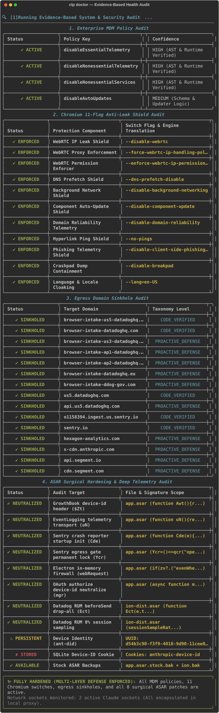
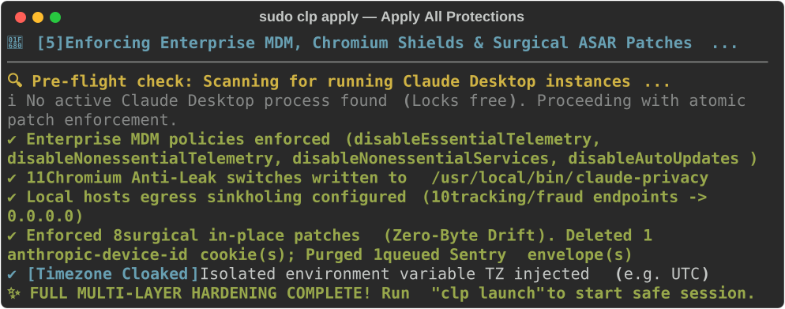
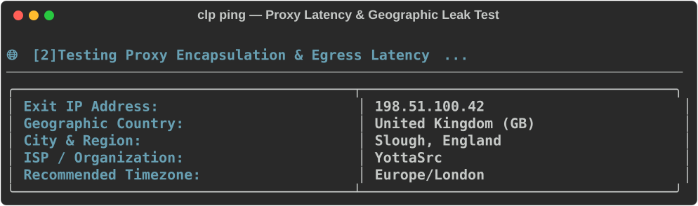
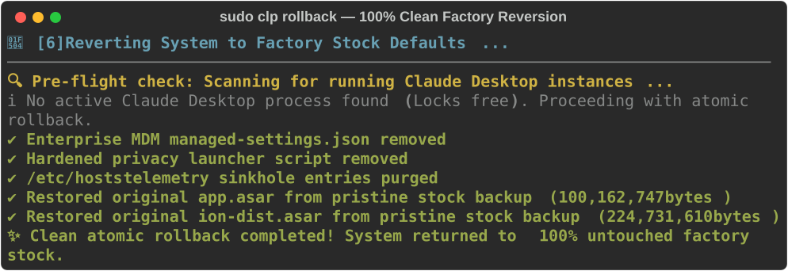

# Claude Patcher (`clp`)

> [!CAUTION]
> **EXPERIMENTAL VERSION — USE AT YOUR OWN RISK**
>
> **This release is experimental and under active testing.**
> **NEVER test or use this tool on an important account or any account with an active paid subscription.** Runtime patching of Claude Desktop may trigger account flags, suspensions, or unexpected behavior. Only test with disposable/non-critical accounts.

<div align="center">

[](LICENSE)
[](https://github.com/dalroot/claude-patcher)
[](https://github.com/dalroot/claude-patcher)
[](https://github.com/dalroot/claude-patcher)
[](https://github.com/dalroot/claude-patcher)

[🇮🇷 مطالعه راهنمای کامل فارسی (README_FA.md)](README_FA.md)

</div>

<p align="center">
  
</p>

---

## 🚫 Why Claude Accounts Get Banned (And Why VPNs Alone Are Not Enough)

Users connecting to **Claude Desktop** from sanctioned, restricted, or non-supported regions (such as Iran) frequently face **abrupt account suspensions, payment terminations, and silent shadowbans**—even while actively connected to high-grade VPNs, V2Ray nodes, or SOCKS5 proxies.

### The Anatomy of an Account Ban
Anthropic employs an aggressive, multi-layered anti-fraud and compliance scoring system. A VPN only encrypts outbound HTTP/TCP traffic; it **does not protect you** from the host-level signals that Claude Desktop continuously harvests from your operating system:

1. **WebRTC STUN UDP Leaks (Direct ISP Exposure):** Chromium's embedded WebRTC engine initiates peer-to-peer UDP STUN queries directly through your domestic network adapter, bypassing system proxies and exposing your real public IP and local ISP.
2. **Speculative DNS Prefetching:** Chromium pre-resolves hostnames in the background through domestic router/OS DNS resolvers before you interact with them, leaving unencrypted query logs with local ISPs.
3. **Persistent Hardware Fingerprinting (`ant-did` & SQLite Cookies):** Claude generates an isolated install UUID (`ant-did`) and binds an `anthropic-device-id` cookie into local SQLite storage. When switching accounts or proxies, this static fingerprint instantly ties your new session to previous banned identities.
4. **Behavioral Fraud Scoring (Sift & FingerprintJS):** Embedded telemetry scripts score mouse kinematics, WebGL GPU rendering signatures, canvas data, installed system fonts, and incognito states, dispatching risk telemetry to fraud evaluation beacons.
5. **GrowthBook Device Injection:** Background feature-flag polling routinely transmits the `anthropic-device-id` header to internal ingestion endpoints.
6. **Telemetry & Crashpad Ingestion:** EventLogging flushes batches of up to 50 system events (RAM, CPU, machine architecture) to `/api/event_logging/v2/batch`, while Crashpad minidumps exfiltrate stack traces containing domestic environment variables.
7. **Timezone & Locale Discrepancies:** System clocks (e.g., Tehran IRST / GMT+3:30) contradictory to the VPN exit node country (e.g., Frankfurt CET / GMT+1:00) serve as instant triggers for location evasion bans.

**Claude Patcher (`clp`)** operates directly inside the Claude Desktop runtime to dismantle every single ban trigger, establishing a zero-leak, enterprise-hardened environment without requiring any reconfiguration of your external VPN client.

---

## 🛡️ Full-Spectrum Protection Architecture

Claude Patcher establishes defense-in-depth across **6 specialized layers**:

```
┌────────────────────────────────────────────────────────────────────────┐
│                      CLAUDE DESKTOP RUNTIME                            │
├────────────────────────────────────────────────────────────────────────┤
│ 1. Enterprise MDM Layer    ──> Official Telemetry & Update Suppression │
│ 2. Chromium 11-Switch Core ──> WebRTC, DNS Prefetch & Ping Shutdown   │
│ 3. 8-Layer Surgical ASAR   ──> In-Place Zero-Byte AST Neutralization   │
│ 4. Electron Memory Firewall──> Pre-Dispatch Telemetry Dropper          │
│ 5. Process Lifecycle Evict ──> Safe Locking, Auto-Kill & Disk Sync    │
│ 6. Artifact Sanitizer      ──> SQLite Cookies & Sentry Queue Purge     │
└────────────────────────────────────────────────────────────────────────┘
```

### 1. 8-Layer Surgical In-Place ASAR Hardening (Zero-Byte Drift)
Unlike fragile tools that unpack, alter, and repack `.asar` archives (which corrupts file headers and causes launch crashes), `clp` performs **byte-exact, in-place binary substitutions**:
* **Layer 1: GrowthBook Header Neutralization (`app.asar`):** Rewrites `Awt()` to return `!1`, permanently dropping the `anthropic-device-id` header from feature-flag queries.
* **Layer 2: EventLogging Telemetry Transport Kill (`app.asar`):** Rewrites `uN()` to return `!1`, halting the `/api/event_logging/v2/batch` background pipeline uploading system metrics.
* **Layer 3: Sentry Crashpad Startup Bypass (`app.asar`):** Rewrites `Cde()` to return `!1`, completely bypassing Sentry DSN initialization and native `crashReporter.start()`.
* **Layer 4: Sentry Egress Gate Lock (`app.asar`):** Permanently locks the Sentry egress gate (`Ycr`) to verdict `"blocked"`.
* **Layer 5: Electron In-Memory Firewall (`app.asar`):** Intercepts `webRequest.onBeforeRequest` to drop all egress queries matching `datadoghq.com`, `sentry.io`, and `segment.io` before network dispatch—while safely preserving local frontend script assets (`vendor-datadog-*.js`).
* **Layer 6: OAuth Device-ID Cookie Neutralization (`app.asar`):** Rewrites `mgr()` to return `void 0`, preventing `anthropic-device-id` from being attached to OAuth `/authorize` requests.
* **Layer 7: Datadog RUM Drop-All Hook (`ion-dist.asar`):** Forces Datadog RUM `beforeSend` hook (`Ect`) to return `!1`, dropping 100% of telemetry events.
* **Layer 8: Datadog RUM 0% Session Sampling (`ion-dist.asar`):** Forces `sessionSampleRate` from `100` down to `0` across all initialization blocks.

### 2. Automated Process Lifecycle Management (`ensure_claude_closed`)
Pre-flight scanner automatically detects running Claude Desktop instances, delivers graceful `SIGTERM` signals, waits for disk write-backs to prevent SQLite corruption, and safely releases file/socket locks before applying or rolling back patches.

### 3. Multi-User Artifact & Telemetry Sanitizer
Scans all local user home directories (including `SUDO_USER` and multi-user setups) to:
* Eradicate `anthropic-device-id` rows from SQLite `~/.config/Claude/Cookies`.
* Purge queued Sentry envelopes in `~/.config/Claude/sentry/queue/`.
* Remove stale session latches (`oauth:staleSessionLatch`) in `config.json`.

### 4. Official Enterprise MDM Policy Enforcement
Deploys official administrative policy manifests (`managed-settings.json` on Linux, Registry policies on Windows) recognized natively by Claude:
* `disableEssentialTelemetry`: Disables Sentry SDK and activates native `admin_opt_out`.
* `disableNonessentialTelemetry`: Disables telemetry transport and batch log ingestion.
* `disableNonessentialServices`: Disables dictionary downloads, spellcheck beacons, and remote sandboxes.
* `disableAutoUpdates`: Halts automatic update queries and installer transmissions.

### 5. 11 Native Chromium Engine Anti-Leak Switches
Injects hardened runtime flags directly into the Chromium execution layer:
* `--disable-webrtc` & `--force-webrtc-ip-handling-policy=disable_non_proxied_udp`: Blocks all WebRTC UDP STUN requests bypassing proxies.
* `--enforce-webrtc-ip-permission-check`: Enforces strict interface access permissions.
* `--dns-prefetch-disable`: Completely halts speculative DNS lookups (`dnsPrefetchingEnabled=false`).
* `--disable-background-networking`, `--no-pings`, `--disable-domain-reliability`: Kills background telemetry pings and domain reliability auditing.
* `--disable-breakpad`: Shuts down native Breakpad minidump exfiltration.
* `--lang=en-US`: Enforces standard US English to cloak regional OS locale markers.

### 6. Local Egress Domain Sinkholes
Redirects 10+ tracking and fraud evaluation endpoints (including `browser-intake-us5-datadoghq.com`, `hexagon-analytics.com`, and `sentry.io`) directly to `0.0.0.0` at the OS resolver level.

---

## ⚡ Quick One-Line Global Installation

### 🐧 Linux & 🍏 macOS
```bash
curl -fsSL https://raw.githubusercontent.com/dalroot/claude-patcher/main/install.sh | sudo bash
```

### 🪟 Windows (PowerShell Run as Administrator)
```powershell
irm https://raw.githubusercontent.com/dalroot/claude-patcher/main/install.ps1 | iex
```

### 🐍 Universal (pipx / pip)
```bash
pipx install git+https://github.com/dalroot/claude-patcher.git
```

---

## 🚀 Commands & Visual Output Reference

### 1. Interactive Control Center (`clp`)
Run `clp` without arguments to launch the interactive terminal dashboard:
```bash
clp
```
<p align="center">
  
</p>

---

### 2. Evidence-Based Diagnostic Audit (`clp doctor`)
Audits all 4 MDM policies, 11 Chromium switches, local sinkholes, and all 8 surgical ASAR patches:
```bash
clp doctor

# Machine-readable JSON export for automated verification:
clp doctor --json
```
<p align="center">
  
</p>

---

### 3. Enforce All Multi-Layer Protections (`sudo clp apply`)
Executes pre-flight process management, deploys MDM policies, writes Chromium flags, configures sinkholes, and enforces 8 ASAR patches:
```bash
sudo clp apply

# Apply with custom timezone cloaking (e.g. UTC, Europe/London):
sudo clp apply --tz Europe/London
```
<p align="center">
  
</p>

---

### 4. Surgical In-Place ASAR Hardening (`sudo clp patch-asar`)
Directly applies the 8 zero-byte binary AST patches to `app.asar` and `ion-dist.asar` and purges residual SQLite cookies and Sentry envelopes:
```bash
sudo clp patch-asar
```
<p align="center">
  
</p>

---

### 5. Proxy Encapsulation & Egress Latency Test (`clp ping`)
Tests proxy connectivity, verifies exit IP, location, and recommends a matching timezone for cloaking:
```bash
clp ping
```
<p align="center">
  
</p>

---

### 6. Atomic 100% Factory Stock Rollback (`sudo clp rollback`)
Gracefully closes Claude, restores pristine ASAR binaries from `.stock.bak`, removes MDM policies, and purges hosts sinkholes:
```bash
sudo clp rollback
```
<p align="center">
  
</p>

---

### 7. Ephemeral Install UUID Generator (`clp reset-did`)
Generates a fresh, anonymous UUID v4 install identifier to decouple your machine from historical fingerprints:
```bash
clp reset-did
```

---

### 8. Launch Hardened Session (`clp launch`)
Starts Claude Desktop directly under the isolated anti-leak shield:
```bash
clp launch
```

---

## 🛡️ Anti-Leak & Protection Matrix

| Leak Vector | Account Risk | Protection Mechanism | Status |
| :--- | :--- | :--- | :--- |
| **WebRTC STUN Leaks** | Exposes true public IP outside proxy | `--disable-webrtc` & `--force-webrtc-ip-handling-policy=disable_non_proxied_udp` | `ENFORCED` |
| **Speculative DNS Prefetch** | Exposes target hosts to local ISP DNS | `--dns-prefetch-disable` (`dnsPrefetchingEnabled=false`) | `ENFORCED` |
| **GrowthBook Feature Ingest** | Tags requests with `anthropic-device-id` | Surgical in-place AST patch neutralizing `Awt()` in `app.asar` | `NEUTRALIZED` |
| **EventLogging Pipeline** | Batches system metrics to `/v2/batch` | Surgical in-place AST patch killing `uN()` transport in `app.asar` | `NEUTRALIZED` |
| **Sentry Crash Reporter** | Sends minidumps & hardware traces | Surgical in-place AST patch bypassing `Cde()` & locking `Ycr` | `NEUTRALIZED` |
| **In-Memory Egress Leaks** | Telemetry calls bypassing hosts file | Electron `webRequest.onBeforeRequest` regex firewall dropping egress calls | `NEUTRALIZED` |
| **OAuth Device Fingerprint** | Binds sessions to device-id in cookies | Surgical in-place AST patch returning `void 0` in `mgr()` (`app.asar`) | `NEUTRALIZED` |
| **Datadog RUM Telemetry** | Session behavioral & performance beacons | In-place drop-all in `beforeSend` & `sessionSampleRate: 0` (`ion-dist.asar`) | `NEUTRALIZED` |
| **Sift Anti-Fraud Scoring** | Behavioral profiling & bot scoring | Egress sinkhole to `0.0.0.0` (`hexagon-analytics.com`, `s.js`) | `SINKHOLED` |
| **SQLite Device Cookie** | Persistent tracking across sessions | Automated sanitization purging `anthropic-device-id` from `Cookies` DB | `CLEAN` |
| **Timezone Contradiction** | Mismatches VPN exit node location | Per-process isolated `TZ` cloaking injected at runtime | `CLOAKED` |
| **Install UUID Tracking** | Persistent installation correlation | `clp reset-did` regenerates an isolated, anonymous UUID v4 | `ISOLATED` |

---

## 🏗️ Project Architecture & Modularity

`claude-patcher` is architected as an extensible, decoupled Python package adhering strictly to [clig.dev](https://clig.dev) and PEP 517/621 standards:

```text
claude-patcher/
├── claude_patcher/               # Core Python Package
│   ├── __init__.py               # Package public API exports & version metadata
│   ├── __main__.py               # Entrypoint for 'python3 -m claude_patcher'
│   ├── constants.py              # Telemetry matrices, Chromium flags & patch signatures
│   ├── paths.py                  # DynamicPathFinder (Linux, Windows, macOS discovery)
│   ├── system.py                 # Privileged writes, sha256 & process lifecycle
│   ├── network.py                # Geolocation, egress IP & proxy latency testing
│   ├── sanitizer.py              # SQLite cookie scrubber & ant-did identifier manager
│   ├── asar.py                   # Zero-byte in-place surgical ASAR patch engine
│   ├── engines/                  # Platform abstraction engines (OOP architecture)
│   │   ├── base.py               # BasePlatformEngine abstract base class
│   │   ├── linux.py              # LinuxEngine (Managed JSON policies & Bash launcher)
│   │   └── windows.py            # WindowsEngine (HKLM/HKCU dual-hive Registry & Batch)
│   ├── ui/                       # Rich console & visual components
│   │   ├── banner.py             # Claude asterisk header & system telemetry
│   │   └── menu.py               # Interactive rounded menu controls
│   ├── commands/                 # Granular subcommand implementations
│   │   ├── doctor.py             # Evidence-based security audit & JSON exporter
│   │   ├── apply.py              # Multi-layer hardening orchestrator
│   │   ├── rollback.py           # Atomic factory restoration engine
│   │   ├── ping.py               # Egress proxy encapsulation tester
│   │   ├── timezone.py           # Automatic & manual timezone cloaking
│   │   ├── did.py                # Persistent install-id generator
│   │   ├── launch.py             # Cloaked process spawner
│   │   └── asar_cmd.py           # Interactive surgical patch toggle
│   └── cli.py                    # Terminal dispatcher & main interactive loop
├── pyproject.toml                # PEP 517/621 package metadata & entrypoints
├── install.sh                    # Universal Linux/macOS installer
└── install.ps1                   # Universal Windows PowerShell installer
```

---

## 📜 Changelog

### v1.0.0-beta (2026-11-24)
- **Modular Package Architecture:** Refactored monolithic script into a clean, modular Python package (`claude_patcher`) with decoupled domains (`engines`, `ui`, `commands`, `asar`, `sanitizer`, `network`), while maintaining 100% backwards compatibility for direct execution (`./claude_patcher.py`).
- **Full 8-Layer In-Place ASAR Hardening:** Implemented zero-byte drift binary patching for `app.asar` and `ion-dist.asar` covering GrowthBook, EventLogging, Sentry DSN init, Sentry egress verdict gate, Electron in-memory firewall, OAuth device-id read, and Datadog RUM drop-all/zero-sampling.
- **Refined Electron WebRequest Firewall:** Tuned egress filter to target `datadoghq.com`, `sentry.io`, and `segment.io` without interfering with local internal React bundle assets (`vendor-datadog-*.js`).
- **Automated Process Termination Lifecycle (`ensure_claude_closed`):** Automatically scans for active Claude instances, issues graceful `SIGTERM` signals, releases file and SQLite locks, and cleans memory before patch application or rollback.
- **Multi-User Artifact Sanitizer (`sanitize_local_telemetry_artifacts`):** Automatically locates and purges `anthropic-device-id` from SQLite cookie stores, clears residual Sentry envelope queues, and strips stale session latches (`oauth:staleSessionLatch`).
- **Command-Specific Visual Previews:** Embedded dedicated, pixel-perfect terminal cards under each CLI command.
- **Doctor Diagnostic Suite Redesign:** Multi-column evidence-backed audit tables reporting MDM status, 11 Chromium switches, egress sinkholes, and ASAR patch verification with machine-readable `--json` export.
- **Native Stock Backups & Atomic Rollback:** Backs up pristine factory `.stock.bak` files on first run, providing 100% reversible, non-destructive restoration via `clp rollback`.
- **Comprehensive Bilingual Documentation:** Added comprehensive Persian documentation (`README_FA.md`) and technical reverse-engineering reports (`docs/EVIDENCE_FINDINGS_FA.md`).
- **Multi-User Artifact Sanitizer (`sanitize_local_telemetry_artifacts`):** Automatically locates and purges `anthropic-device-id` from SQLite cookie stores, clears residual Sentry envelope queues, and strips stale session latches (`oauth:staleSessionLatch`).
- **Command-Specific Visual Previews:** Embedded dedicated, pixel-perfect terminal cards under each CLI command.
- **Doctor Diagnostic Suite Redesign:** Multi-column evidence-backed audit tables reporting MDM status, 11 Chromium switches, egress sinkholes, and ASAR patch verification with machine-readable `--json` export.
- **Native Stock Backups & Atomic Rollback:** Backs up pristine factory `.stock.bak` files on first run, providing 100% reversible, non-destructive restoration via `clp rollback`.
- **Comprehensive Bilingual Documentation:** Added comprehensive Persian documentation (`README_FA.md`) and technical reverse-engineering reports (`docs/EVIDENCE_FINDINGS_FA.md`).

### v0.9.0
- Added automated local sinkholing for regional Datadog clusters (`browser-intake-us5-datadoghq.com`).
- Introduced per-process isolated `TZ` timezone cloaking without modifying operating system clock.
- Added anonymous install UUID generator (`clp reset-did`).

### v0.5.0
- Initial release featuring Enterprise MDM policies (`managed-settings.json` / Windows Registry) and 11 native Chromium anti-leak switches.

---

## 🔄 Clean Rollback

To remove all configuration changes and return Claude Desktop to factory stock:

```bash
# On Linux / macOS
sudo clp rollback

# On Windows (PowerShell)
clp rollback
```

---

## 📄 License & Terms of Use

This project is licensed under the **Restricted Source-Available Proprietary License (RSAL-1.0)**. See the full [LICENSE](LICENSE) file for exact legal terms.

### Summary of Rights & Restrictions:
- 👁️ **Source-Available:** You are free to inspect and audit the complete source code for personal privacy, security verification, and educational purposes.
- 🛡️ **Personal Use Only:** You may run the software unmodified on your personal devices.
- 🚫 **No Copying or Redistribution:** You may NOT copy, mirror, re-host, redistribute, sublicense, or sell this software or its visual assets for any commercial or non-commercial purpose without prior express written permission from the copyright holder (`dalroot`).
- 🚫 **No Unauthorized Modifications:** You may NOT alter, decompile, create derivative works of, or distribute modified versions of this software.
- 🤝 **Contributions via Pull Request Only:** Independent forks for distribution are strictly forbidden. All development, enhancements, and bug fixes must be contributed directly via a **Pull Request (PR)** to this upstream repository ([dalroot/claude-patcher](https://github.com/dalroot/claude-patcher)).

---

## ⚖️ Disclaimer

This project is an independent source-available privacy shield and is **not affiliated with, endorsed by, or sponsored by Anthropic PBC**. All product names and trademarks are property of their respective owners.
