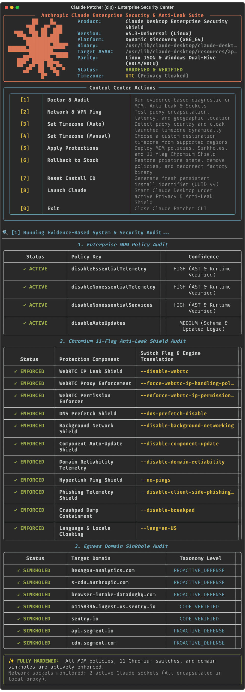

# Claude Patcher (`clp`)

<p align="center">
  <a href="https://github.com/dalroot/claude-patcher/blob/main/LICENSE"></a>
  <a href="https://www.python.org/"></a>
  </a>
  </a>
  </a>
</p>

<p align="center">
  <strong>Universal Enterprise Security & Privacy Hardening Shield for Claude Desktop</strong><br>
  <em>Inhibits behavioral telemetry, WebRTC IP leakage, Sift fingerprinting, Crashpad crash dumps, and DNS prefetching via official Enterprise MDM and Chromium engine switches with zero binary modification.</em>
</p>

<p align="center">
  
</p>

---

## ⚡ Global One-Line Installation

Install `claude-patcher` globally across any operating system with a single command. Once installed, the `clp` command is available immediately from any terminal window.

### 🐧 Linux & 🍏 macOS
```bash
curl -fsSL https://raw.githubusercontent.com/dalroot/claude-patcher/main/install.sh | sudo bash
```
*(Automatically verifies Python, installs `rich`, sets up `/usr/local/bin/claude-patcher` and creates the global `/usr/local/bin/clp` symlink)*

### 🪟 Windows (PowerShell)
```powershell
irm https://raw.githubusercontent.com/dalroot/claude-patcher/main/install.ps1 | iex
```
*(Automatically verifies Python, configures `%LOCALAPPDATA%\Programs\claude-patcher`, and registers `clp.cmd` into User PATH and WindowsApps)*

### 🐍 Universal Python Package (pipx / pip)
```bash
# Recommended via pipx (isolated environment)
pipx install git+https://github.com/dalroot/claude-patcher.git

# Or standard pip
pip install git+https://github.com/dalroot/claude-patcher.git
```

---

## 🚀 Usage & Commands

Run `clp` from any terminal to launch the interactive Security Center, or run subcommands directly for headless CI/CD automation:

```bash
# Launch Interactive Rich TUI Control Center
clp

# Run Evidence-Based Health Audit
clp doctor

# Machine-Readable JSON Export (CI/CD Auditing)
clp doctor --json

# Deploy Protections (MDM Policies, 11-Flag Chromium Shield, Hosts Sinkholes)
sudo clp apply

# Custom Timezone Cloaking (e.g., UTC, America/New_York)
sudo clp apply --tz UTC

# 100% Clean Atomic Rollback to Factory Stock
sudo clp rollback

# Network Proxy Latency & Encapsulation Diagnostic
clp ping

# Regenerate Anonymous Persistent Install UUID (ant-did)
clp reset-did

# Launch Hardened Claude Desktop Session
clp launch
```

---

## 🛡️ Architecture & Threat Neutralization

`claude-patcher` (`clp`) is an evidence-first security suite developed through deep reverse-engineering of official Claude Desktop Linux distributions (`v1.24012.11`, `v6.28899.6`) and Windows MSIX packages (`Claude-win-6.28899.6.msix`).

### 1. Enterprise MDM Integration (Zero Binary Tampering)
Anthropic builds enterprise policy consumption into Claude Desktop via `jJt()` (Linux) and `AJt()` / `kJt()` (Windows dual-hive registry). `clp` activates these official gates without modifying code signatures:

| Policy Key | Target Layer | AST Consumer & Mechanism |
| :--- | :--- | :--- |
| `disableEssentialTelemetry` | Sentry & Crashpad | `Q9s()` disables Sentry SDK; `Yva()` passes `admin_opt_out` to Crashpad |
| `disableNonessentialTelemetry` | Event Logging Batch | `uN()` checks state; `qTr()` halts network transport to `/api/event_logging/v2/batch` |
| `disableNonessentialServices` | Dictionaries & Sandboxes | `bFs()` halts dictionary downloads; `eEa()` disables spellcheck menu |
| `disableAutoUpdates` | Background Poller | `yWt()` inhibits background update polling and telemetry payload |

### 2. Chromium 11-Switch Anti-Leak Shield
Injected at the native C++ engine level before binary startup:

- **WebRTC IP Leak Shield:** `--disable-webrtc`, `--force-webrtc-ip-handling-policy=disable_non_proxied_udp`, `--enforce-webrtc-ip-permission-check`
- **DNS Prefetch Isolation:** `--dns-prefetch-disable` *(automatically translated by Chromium into `--blink-settings=dnsPrefetchingEnabled=false` in Renderers)*
- **Background Telemetry Isolation:** `--disable-background-networking`, `--disable-component-update`, `--disable-domain-reliability`, `--no-pings`, `--disable-client-side-phishing-detection`
- **Crash Containment & Locale Cloaking:** `--disable-breakpad`, `ELECTRON_ENABLE_LOGGING=0`, `--lang=en-US`, `LANG=en_US.UTF-8`

### 3. Proactive Egress Domain Sinkholing
Blocks known telemetry, error monitoring, and anti-fraud fingerprinting beacons directly to `0.0.0.0`:
- `hexagon-analytics.com` (Sift anti-fraud tracking endpoint)
- `s-cdn.anthropic.com` (Sift FingerprintJS script distribution CDN)
- `browser-intake-datadoghq.com` (Datadog RUM telemetry ingest)
- `o1158394.ingest.us.sentry.io` & `sentry.io` (Anthropic dedicated error reporting)
- `api.segment.io` & `cdn.segment.com` (Segment analytics collection)

---

## ⚖️ Cross-Platform Parity

| Feature | Linux (`LinuxEngine`) | Windows (`WindowsEngine`) |
| :--- | :--- | :--- |
| **MDM Storage** | `/etc/claude-desktop/managed-settings.json` | Registry `HKLM` & `HKCU\SOFTWARE\Policies\Claude` |
| **No-Admin Mode** | Supported (User configs) | **Supported** (`HKCU` user hive queries) |
| **Hosts Sinkhole** | `/etc/hosts` | `%SystemRoot%\System32\drivers\etc\hosts` |
| **Process Launcher** | `/usr/local/bin/claude-privacy` (Bash) | `%LOCALAPPDATA%\Claude\claude-privacy.cmd` (Batch) |
| **Binary Discovery** | `DynamicPathFinder` (`/usr/lib`, `/opt`, `PATH`) | `DynamicPathFinder` (`WindowsApps`, `PATH`, `LOCALAPPDATA`) |
| **Rollback Engine** | Atomic file removal & symlink restore | Atomic registry cleanup & hosts rollback |

---

## 🔄 Atomic Rollback

To completely revert all system changes and return Claude Desktop to factory stock:

```bash
# On Linux
sudo clp rollback

# On Windows (PowerShell)
clp rollback
```

This atomically:
1. Removes MDM configuration files and Registry policy keys.
2. Restores pristine `hosts` backup without leftover entries.
3. Removes privacy wrappers and restores default desktop launchers.

---

## ⚖️ Disclaimer

This project is an independent open-source utility and is **not affiliated with, endorsed by, or sponsored by Anthropic PBC**. All trademarks, logos, and brand names are the property of their respective owners.
