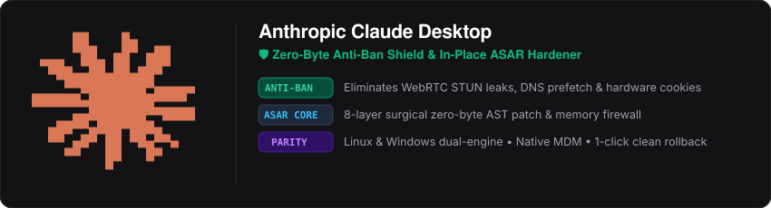
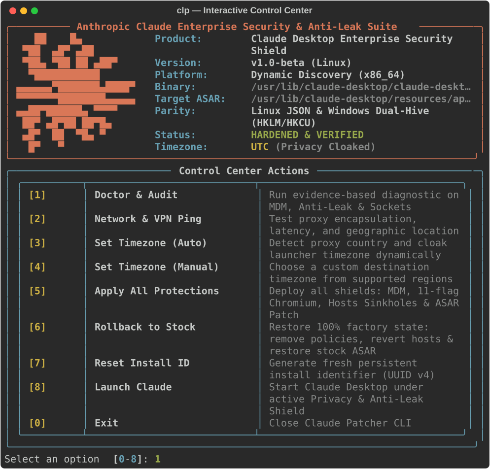
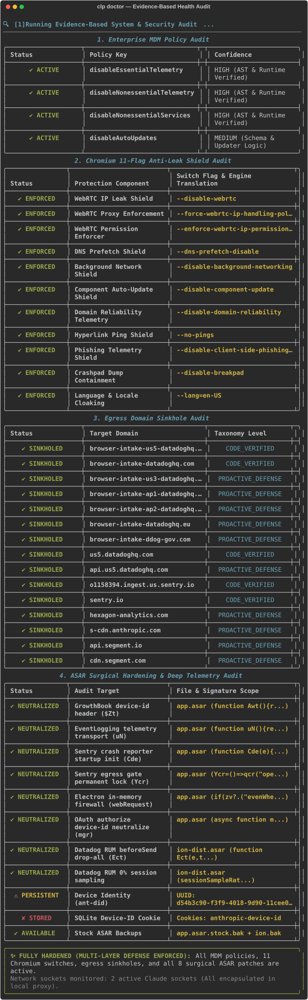
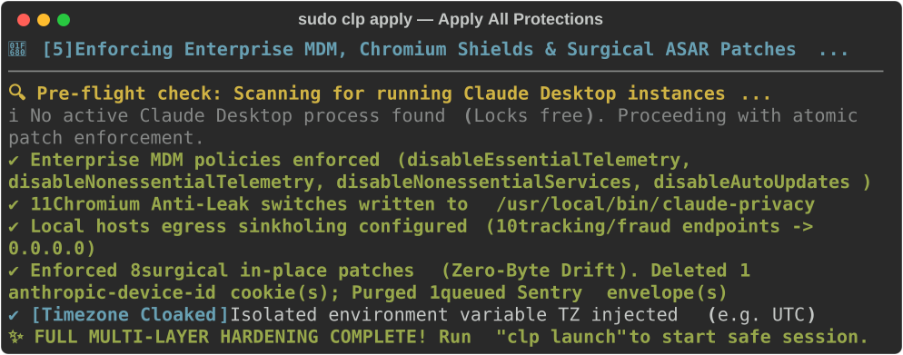
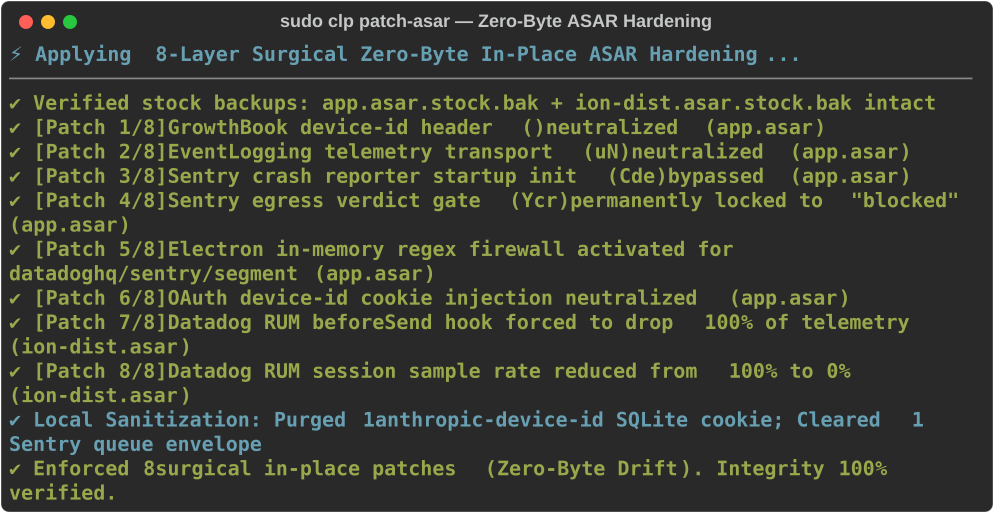
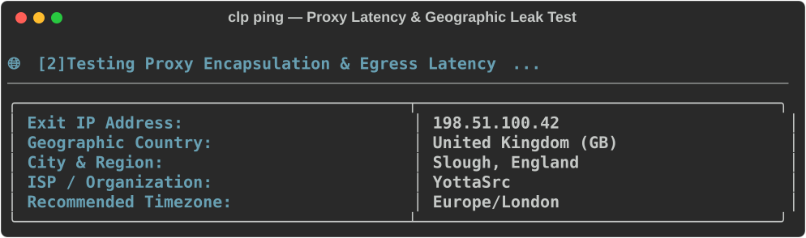
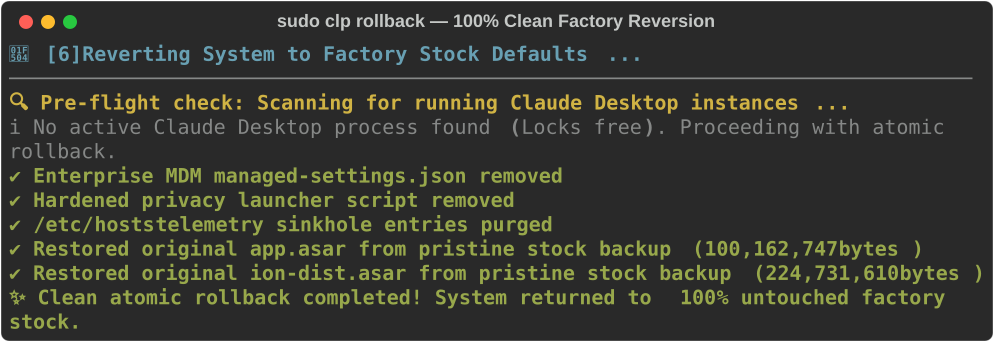

<div dir="rtl">

# کلود پچر (`clp`) — سپر امنیتی ضد نشت و ضد مسدودی اکانت‌های Claude Desktop

<div align="center">

[](LICENSE)
[](https://github.com/dalroot/claude-patcher)
[](https://github.com/dalroot/claude-patcher)
[](https://github.com/dalroot/claude-patcher)
[](https://github.com/dalroot/claude-patcher)

[English Documentation (README.md)](README.md)

</div>

<p align="center">
  
</p>

---

## 🚫 چرا اکانت‌های کلاود بن می‌شوند؟ (و چرا وی‌پی‌ان به تنهایی کافی نیست؟)

بسیاری از کاربران ایرانی و ساکنان مناطق تحت تحریم، علی‌رغم اتصال مداوم به بهترین فیلترشکن‌ها، نودهای V2Ray یا پروکسی‌های پایدار SOCKS5، به طور ناگهانی با **مسدود شدن حساب (Ban)، لغو اشتراک‌های پولی یا خطاهای دسترسی** مواجه می‌شوند.

### کالبدشکافی مسدودسازی اکانت توسط انتروپیک:
فیلترشکن فقط ترافیک عمومی وب را رمزگذاری می‌کند؛ اما برنامه کلاود دسکتاپ بر پایه **Electron** (ترکیب کرومیوم و Node.js) ساخته شده و به طور مداوم داده‌های زیر را مستقیماً از سیستم‌عامل شما استخراج کرده و به سرورهای ضدتقلب مخابره می‌کند:

1. **نشت مخفی آی‌پی واقعی از طریق WebRTC STUN:** پروتکل WebRTC در کرومیوم برای کشف مسیر، پکت‌های مستقیم UDP ارسال می‌کند که پروکسی‌ها و SOCKS5 را دور می‌زنند و آی‌پی واقعی ایران و ISP شما را مستقیماً به کلاود لو می‌دهند.
2. **پیش‌بارگذاری حدسی دامنه‌ها (DNS Prefetching):** کرومیوم دامنه‌ها را قبل از کلیک، از طریق DNS محلی سیستم و مودم استعلام می‌کند و ردپای ارتباط را در شبکه داخلی به جا می‌گذارد.
3. **شناسه سخت‌افزاری و کوکی‌های پایدار (`ant-did` و SQLite):** کلاود یک شناسه یکتا در فایل `ant-did` و یک کوکی سخت‌افزاری به نام `anthropic-device-id` در دیتابیس محلی ذخیره می‌کند. حتی اگر اکانت یا وی‌پی‌ان خود را عوض کنید، این امضا فوراً هویت شما را به اکانت‌های مسدودشده قبلی پیوند می‌دهد!
4. **سیستم ارزیابی تقلب سیفت (Sift Fraud Scoring):** اسکریپت‌های رفتاری سیفت، حرکات ماوس، امضای گرافیکی WebGL، فونت‌های سیستم و حالت‌های ناشناس را می‌سنجند و نمره ریسک جعل هویت برای اکانت شما ثبت می‌کنند.
5. **تزریق شناسه دستگاه در فچرهای GrowthBook:** در هر بار باز شدن برنامه، کلاود شناسه دستگاه شما را همراه با استعلام فلگ‌های سیستمی مخابره می‌کند.
6. **مخابره دسته‌ای لاگ‌ها (EventLogging) و کرش‌پد (Crashpad):** دسته‌های ۵۰تایی از رویدادها (شامل رم، پردازنده، معماری و مشخصات ماشین) به آدرس `/api/event_logging/v2/batch` فرستاده شده و مینی‌دامپ‌های کرش‌پد مشخصات محیطی را به بیرون درز می‌دهند.
7. **تضاد فاحش ساعت سیستم با کشور پروکسی:** اگر ساعت سیستم شما روی تهران (IRST / GMT+3:30) باشد اما پروکسی شما آلمان باشد، این مغایرت بلافاصله به عنوان تقلب برای دور زدن مرزها شناسایی و پرچم‌گذاری می‌شود.

**کلود پچر (`clp`)** دقیقاً در درون محیط کلاینت کلاود وارد عمل شده و تمامی این سرنخ‌های ردیابی را به طور کامل قطع می‌کند، بدون اینکه نیازی به دستکاری کلاینت وی‌پی‌ان یا تغییر ساعت ویندوز/لینوکس شما باشد.

---

## 🛡️ معماری دفاعی چندلایه پچر

پچر حفاظت از نشست‌های شما را در **۶ لایه مستقل و مکمل** پیاده‌سازی می‌کند:

```
┌────────────────────────────────────────────────────────────────────────┐
│                      محیط اجرایی CLAUDE DESKTOP                         │
├────────────────────────────────────────────────────────────────────────┤
│ ۱. لایه مدیریت سازمانی MDM ──> خاموش‌سازی رسمی تلمتری و آپدیت خودکار  │
│ ۲. ۱۱ سوییچ هسته کرومیوم   ──> قفل کامل نشت WebRTC، DNS و پینگ‌های موتور │
│ ۳. ۸ لایه پچ جراحی ASAR   ──> خنثی‌سازی کدها بدون تغییر طول بایت       │
│ ۴. فایروال درون‌حافظه‌ای  ──> Drop کردن درخواست‌های تلمتری در الکترون   │
│ ۵. چرخه حیات و قفل پروسه  ──> بستن خودکار برنامه‌ها و آزادسازی حافظه    │
│ ۶. پاک‌سازی آثار محلی     ──> حذف کوکی‌های SQLite و صف‌های سنتری       │
└────────────────────────────────────────────────────────────────────────┘
```

### ۱. هشت لایه پچ جراحی درجا در فایل‌های ASAR (تضمین صفر بایت جابه‌جایی)
برخلاف ابزارهای غیرحرفه‌ای که آرشیو ASAR را Unpack و مجدداً Repack می‌کنند (که ساختار هدر را خراب کرده و باعث کرش برنامه می‌شود)، پچر تعویض‌های بایت‌به‌بایت درجا انجام می‌دهد:
* **لایه ۱ (GrowthBook در `app.asar`):** تابع `Awt` را به `return !1` بازنویسی می‌کند تا هدر `anthropic-device-id` هرگز تزریق نشود.
* **لایه ۲ (EventLogging در `app.asar`):** تابع `uN` را به `return !1` بازنویسی می‌کند تا خط لوله مخابره متادیتای سیستم به طور کامل قطع شود.
* **لایه ۳ (Sentry Init در `app.asar`):** تابع `Cde` را به `return !1` بازنویسی کرده و از مقداردهی DSN و راه‌اندازی Crashpad جلوگیری می‌کند.
* **لایه ۴ (Sentry Egress در `app.asar`):** خروجی تصمیم‌گیری سنتری (`Ycr`) را برای همیشه روی `"blocked"` قفل می‌کند.
* **لایه ۵ (فایروال درون‌حافظه‌ای الکترون در `app.asar`):** با هوشمندی کامل، ترافیک خروجی به دامنه‌های `datadoghq.com`، `sentry.io` و `segment.io` را بلاک می‌کند، بدون اینکه به فایل‌های داخلی جاوااسکریپت فرانت‌اند برنامه (`vendor-datadog-*.js`) آسیبی برسد.
* **لایه ۶ (کوکی سخت‌افزاری OAuth در `app.asar`):** تابع `mgr` را به `return void 0` بازنویسی کرده و از اتصال شناسه دستگاه به نشست‌های لاگین جلوگیری می‌کند.
* **لایه ۷ (دراپ ۱۰۰٪ دیتاداگ در `ion-dist.asar`):** هوک `beforeSend` دیتاداگ (`Ect`) را به `return !1` تغییر می‌دهد تا هیچ دیتایی مخابره نشود.
* **لایه ۸ (صفر کردن نرخ نمونه‌برداری دیتاداگ در `ion-dist.asar`):** مقدار `sessionSampleRate` را از ۱۰۰ به ۰ کاهش می‌دهد.

### ۲. مدیریت خودکار پروسه‌ها قبل از پچ (`ensure_claude_closed`)
سیستم پیش از اعمال پچ یا بازگردانی (Rollback)، پروسه‌های باز کلاود را به آرامی با `SIGTERM` می‌بندد تا فایل‌های دیتابیس SQLite آسیب نبینند و قفل فایلی روی دیسک آزاد شود.

### ۳. پاک‌سازی خودکار کوکی‌ها و لاگ‌های مانده در سیستم
پچر تمام دایرکتوری‌های کاربران سیستم را جستجو کرده و:
* رکوردهای شناسه دستگاه (`anthropic-device-id`) را از دیتابیس SQLite فایل `Cookies` حذف می‌کند.
* صف‌های ارسال‌نشده سنتری در `~/.config/Claude/sentry/queue/` را تخلیه می‌کند.
* قفل نشست‌های قدیمی و منقضی (`oauth:staleSessionLatch`) را از `config.json` پاک می‌کند.

### ۴. فعال‌سازی سیاست‌های رسمی سازمانی (Enterprise MDM)
استفاده از سازوکار رسمی انتروپیک برای شرکت‌های بزرگ (`managed-settings.json` در لینوکس و پالیسی‌های رجیستری در ویندوز):
* خاموش‌سازی کامل تلمتری‌های ضروری و غیرضروری.
* غیرفعال‌سازی سرویس‌های حاشیه‌ای و آپدیت خودکار برنامه.

### ۵. مهار نشت در هسته مرورگر با ۱۱ سوییچ C++ کرومیوم
اجرای کلاود با پرچم‌های سخت‌گیرانه: مسدودسازی کامل UDP مستقیم WebRTC، خاموش کردن پیش‌بارگذاری DNS، غیرفعال‌سازی سیستم گزارش کرش بومی و پینگ‌های پس‌زمینه.

### ۶. مسدودسازی دامنه‌های ردیابی و تقلب در سطح سیستم (Sinkholing)
هدایت بیش از ۱۰ دامنه فعال ردیابی و امتیازدهی تقلب (شامل `browser-intake-us5-datadoghq.com`، `hexagon-analytics.com` و سرورهای سنتری) به آدرس خنثی `0.0.0.0`.

---

## ⚡ دستور نصب آسان و تک‌خطی

### 🐧 لینوکس و 🍏 مک:
```bash
curl -fsSL https://raw.githubusercontent.com/dalroot/claude-patcher/main/install.sh | sudo bash
```

### 🪟 ویندوز (PowerShell به صورت Run as Administrator):
```powershell
irm https://raw.githubusercontent.com/dalroot/claude-patcher/main/install.ps1 | iex
```

### 🐍 نصب سراسری از طریق پایتون (محیط ایزوله pipx یا pip):
```bash
pipx install git+https://github.com/dalroot/claude-patcher.git
```

---

## 🚀 راهنمای تصویری و خروجی زنده فرامین

### ۱. داشبورد و کنترل‌سنتر تعاملی (`clp`)
با اجرای دستور `clp` بدون پارامتر، داشبورد تعاملی و ترمینالی باز می‌شود:
```bash
clp
```
<p align="center">
  
</p>

---

### ۲. ممیزی و تست عینی سلامت سیستم (`clp doctor`)
ارزیابی تمام ۴ پالیسی سازمانی، ۱۱ سوییچ کرومیوم، سینک‌هول‌ها و هر ۸ لایه پچ ASAR با خروجی دقیق:
```bash
clp doctor

# دریافت خروجی استاندارد JSON برای پایپ‌لاین‌ها و تست خودکار:
clp doctor --json
```
<p align="center">
  
</p>

---

### ۳. اعمال یکجای تمامی لایه‌های محافظتی (`sudo clp apply`)
مدیریت پروسه‌ها، اعمال MDM، تنظیم سوییچ‌های کرومیوم، سینک‌هول‌ها، ۸ پچ ASAR و پاک‌سازی کوکی‌ها:
```bash
sudo clp apply

# اعمال با شبیه‌سازی ساعت متناسب با لوکیشن سرور (مثلاً UTC یا لندن):
sudo clp apply --tz Europe/London
```
<p align="center">
  
</p>

---

### ۴. اعمال مستقیم ۸ لایه پچ جراحی ASAR (`sudo clp patch-asar`)
اعمال بایت‌به‌بایت پچ‌های درجا روی فایل‌های `app.asar` و `ion-dist.asar` و پاک‌سازی صف‌های کش‌شده:
```bash
sudo clp patch-asar
```
<p align="center">
  
</p>

---

### ۵. تست پینگ و بررسی نشت موقعیت مکانی پروکسی (`clp ping`)
تست ارتباط پروکسی، تشخیص آی‌پی خروجی، موقعیت جغرافیایی و پیشنهاد بهترین منطقه زمانی:
```bash
clp ping
```
<p align="center">
  
</p>

---

### ۶. بازگشت ۱۰۰٪ تمیز و اتمیک به تنظیمات اولیه (`sudo clp rollback`)
بستن ایمن کلاود، بازگردانی فایل‌های ASAR فابریک از روی `.stock.bak` و حذف پالیسی‌ها و سینک‌هول‌ها:
```bash
sudo clp rollback
```
<p align="center">
  
</p>

---

### ۷. ریست شناسه تصادفی نصب دستگاه (`clp reset-did`)
تولید یک شناسه یکتای تصادفی جدید (UUID v4) برای قطع ارتباط دستگاه با سشن‌های قبلی:
```bash
clp reset-did
```

---

### ۸. اجرای کلاود زیر چتر محافظتی (`clp launch`)
اجرای امن و مستقیم کلاود دسکتاپ با ۱۱ سوییچ ضد نشت و ساعت شبیه‌سازی‌شده:
```bash
clp launch
```

---

## 📊 جدول مقایسه بردار نشت و مقابله پچر

| بردار نشت | خطر مسدودسازی اکانت | سازوکار مقابله پچر | وضعیت در سیستم |
| :--- | :--- | :--- | :--- |
| **نشت WebRTC STUN** | افشای IP عمومی واقعی ایران با دور زدن پروکسی | قطع پکت‌های مستقیم UDP با سوییچ‌های هسته کرومیوم | `ENFORCED` |
| **پیش‌بارگذاری حدسی DNS** | ثبت لاگ دامنه‌ها در DNS سرور مخابرات/ISP | غیرفعال‌سازی پیش‌بارگذاری DNS در موتور مرورگر | `ENFORCED` |
| **استعلام‌های GrowthBook** | مخابره شناسه دستگاه در هدرهای سیستمی | پچ جراحی ۳۱ بایتی در `app.asar` و خنثی‌سازی `Awt` | `NEUTRALIZED` |
| **خط لوله EventLogging** | ارسال مشخصات رم، پردازنده و لاگ‌های کاربری | پچ جراحی در `app.asar` و قطع خط لوله `uN` | `NEUTRALIZED` |
| **گزارش کرش Sentry** | ارسال مینی‌دامپ‌های حاوی متغیرهای محیطی سیستم | مسدودسازی اولیه `Cde` و قفل دائم خروجی روی `blocked` | `NEUTRALIZED` |
| **فایروال الکترون** | استعلام‌های تلمتری با دور زدن فایل hosts | دراپ مستقیم دیتاداگ، سنتری و سگمنت در `onBeforeRequest` | `NEUTRALIZED` |
| **کوکی سخت‌افزاری OAuth** | شناسایی اکانت جدید از طریق کوکی دستگاه | جلوگیری از تزریق کوکی شناسه در تابع `mgr` | `NEUTRALIZED` |
| **تلمتری Datadog RUM** | مخابره ریز رفتار و کارایی رابط کاربری | دراپ ۱۰۰٪ داده‌ها در `beforeSend` و نرخ نمونه‌برداری ۰٪ | `NEUTRALIZED` |
| **امتیازدهی تقلب سیفت (Sift)** | ساخت پروفایل جعل هویت و ابزارهای دور زدن | هدایت سرورهای آنالیز به `0.0.0.0` در فایل hosts | `SINKHOLED` |
| **کوکی پایدار SQLite** | پیوند دادن سشن‌های متوالی کاربر | اسکن و حذف خودکار رکورد `anthropic-device-id` | `CLEAN` |
| **تناقض ساعت سیستم** | لو رفتن مرز جغرافیایی به دلیل اختلاف ساعت | تزریق ساعت سازگار با پروکسی (`TZ`) صرفاً به کلاود | `CLOAKED` |
| **شناسه نصب (`ant-did`)** | ردگیری دائمی ماشین روی اکانت‌های مختلف | تولید مجدد شناسه تصادفی و پاکسازی با `clp reset-did` | `ISOLATED` |

---

## 🏗️ معماری ماژولار و ساختار پروژه

پروژه `claude-patcher` به صورت یک پکیج استاندارد، ماژولار و کامپوننت‌محور در پایتون بر پایه استانداردهای [clig.dev](https://clig.dev) و PEP 517/621 بازطراحی شده است:

```text
claude-patcher/
├── claude_patcher/               # پکیج اصلی پایتون
│   ├── __init__.py               # اکسپورت‌های پابلیک API و متادیتای پکیج
│   ├── __main__.py               # نقطه ورودی اجرای 'python3 -m claude_patcher'
│   ├── constants.py              # ماتریس‌های تلمتری، سوییچ‌های کرومیوم و امضاهای باینری
│   ├── paths.py                  # کلاس DynamicPathFinder (کشف مسیرهای لینوکس، ویندوز، مک)
│   ├── system.py                 # عملیات امن فایل، روت/سودو و مدیریت چرخه حیات پروسه‌ها
│   ├── network.py                # بررسی لوکیشن خروجی پروکسی و تاخیر شبکه
│   ├── sanitizer.py              # اسکرابر دیتابیس کوکی SQLite و مدیریت شناسه‌های ردیابی
│   ├── asar.py                   # موتور پچ جراحی باینری ASAR با حفظ طول بایت‌ها
│   ├── engines/                  # موتورهای پلتفرم (معماری شیءگرا OOP)
│   │   ├── base.py               # اینترفیس پایه انتزاعی BasePlatformEngine
│   │   ├── linux.py              # پیاده‌سازی لینوکس (پالیسی‌های JSON و لانچر Bash)
│   │   └── windows.py            # پیاده‌سازی ویندوز (رجیستری دوگانه HKLM/HKCU و اسکریپت CMD)
│   ├── ui/                       # کامپوننت‌های رندرینگ Rich و ظاهر خط فرمان
│   │   ├── banner.py             # بنر ستاره‌ای رسمی کلاود و مشخصات زنده سیستم
│   │   └── menu.py               # منوی انتخابی تعاملی گرد
│   ├── commands/                 # هندلرهای تفکیک‌شده برای هر دستور
│   │   ├── doctor.py             # ابزار ممیزی و تست سلامت سیستم با خروجی JSON
│   │   ├── apply.py              # ارکستراتور اعمال چندلایه حفاظت‌ها
│   │   ├── rollback.py           # موتور بازگردانی اتمیک به وضعیت اولیه کارخانه
│   │   ├── ping.py               # بررسی ایزولاسیون پروکسی و تاخیر پینگ
│   │   ├── timezone.py           # پوشش هوشمند و دستی ساعت منطقه زمانی
│   │   ├── did.py                # بازتولید شناسه تصادفی نصب
│   │   ├── launch.py             # اجرای ایمن کلاود در محیط ایزوله
│   │   └── asar_cmd.py           # بررسی و تغییر تعاملی پچ‌های باینری
│   └── cli.py                    # پارسر دستورات ترمینال و لوپ تعاملی
├── pyproject.toml                # متادیتای پکیج و پیکربندی PEP 517/621
├── install.sh                    # اینستالر یونیورسال لینوکس و مک
└── install.ps1                   # اینستالر یونیورسال پاورشل ویندوز
```

---

## 📜 تاریخچه تغییرات و نسخه‌ها (Changelog)

### نسخه ۱.۰.۰ بتا (v1.0.0-beta - ۲۰۲۶-۱۱-۲۴)
* **معماری کاملاً ماژولار پکیج پایتون:** بازطراحی اسکریپت یکپارچه به پکیج ماژولار تفکیک‌شده (`claude_patcher`) با جداسازی حوزه‌های مختلف کاری (`engines`, `ui`, `commands`, `asar`, `sanitizer`, `network`) با حفظ سازگاری ۱۰۰٪ برای اجرای مستقیم اسکریپت (`./claude_patcher.py`).
* **معماری کامل ۸ لایه پچ جراحی ASAR:** پیاده‌سازی پچ‌های بایت‌به‌بایت بدون تغییر اندازه (Zero-Byte Drift) برای `app.asar` و `ion-dist.asar` شامل خنثی‌سازی هدر GrowthBook، قطع خط لوله EventLogging، مهار استارتاپ و قفل گیت سنتری، فایروال درون‌حافظه‌ای الکترون، خنثی‌سازی خواندن کوکی دستگاه در OAuth، و دراپ ۱۰۰٪ لاگ‌های دیتاداگ فرانت‌اند.
* **فایروال هوشمند در هسته الکترون:** تنظیم دقیق فیلتر `webRequest.onBeforeRequest` برای دامنه‌های واقعی تلمتری (`datadoghq.com`، `sentry.io`، `segment.io`) بدون مسدود کردن چانک‌های کد داخلی فرانت‌اند برنامه (`vendor-datadog-*.js`).
* **مدیریت خودکار چرخه حیات پروسه (`ensure_claude_closed`):** بستن هوشمند و ایمن پروسه‌های باز کلاود با سیگنال `SIGTERM` و آزادسازی حافظه قبل از اعمال یا رول‌بک پچ‌ها برای جلوگیری از تداخل فایلی.
* **پاک‌سازی عمیق آثار محلی تلمتری:** پاک‌سازی خودکار رکوردهای `anthropic-device-id` در دیتابیس `Cookies`، تخلیه صف‌های مانده سنتری و حذف قفل نشست‌های منقضی (`oauth:staleSessionLatch`).
* **کارت‌های تصویری مجزا برای هر دستور:** گنجاندن پیش‌نمایش ترمینالی باکیفیت به صورت اختصاصی زیر هر دستور در ردمی.
* **بازطراحی داشبورد ممیزی `clp doctor`:** اضافه شدن جداول رنگی ارزیابی وضعیت ۸ لایه پچ ASAR، گزارش کوکی‌ها و صف‌ها به همراه قابلیت استخراج دیتای ساختاریافته `--json`.
* **بک‌آپ فابریک و رول‌بک اتمیک:** تهیه نسخه پشتیبان `stock.bak` دست‌نخورده در اولین اجرا و امکان بازگشت ۱۰۰٪ امن به تنظیمات اولیه با یک دستور.
* **مستندسازی دوزبانه جامع:** ارائه مستندات فنی و راهنمای فارسی روان به همراه گزارش مهندسی معکوس.

### نسخه ۰.۹.۰ (v0.9.0)
* اضافه شدن سیستم مسدودسازی محلی کلاسترهای منطقه‌ای دیتاداگ در فایل hosts.
* معرفی ایزولاسیون منطقه زمانی (`TZ`) اختصاصی برای پردازش کلاود بدون تغییر ساعت سیستم‌عامل.
* اضافه شدن ابزار ریست شناسه تصادفی دستگاه (`clp reset-did`).

### نسخه ۰.۵.۰ (v0.5.0)
* انتشار اولین نسخه آزمایشی بر پایه پالیسی‌های رسمی Enterprise MDM و ۱۱ سوییچ ضد نشت کرومیوم.

---

## 🔄 بازگشت کامل به تنظیمات کارخانه (Rollback)

هر زمان که بخواهید سیستم و برنامه کلاود را دقیقاً به حالت خام اولیه برگردانید:

```bash
# در لینوکس یا مک:
sudo clp rollback

# در ویندوز (پاورشل):
clp rollback
```

---

## 📄 لایسنس و شرایط استفاده (License & Terms of Use)

این پروژه تحت لایسنس اختصاصی **سورس در دسترس با حقوق محفوظ (Restricted Source-Available Proprietary License - RSAL-1.0)** منتشر شده است. متن کامل حقوقی را در فایل [LICENSE](LICENSE) مطالعه فرمایید.

### خلاصه شرایط و حقوق قانونی:
* 👁️ **سورس در دسترس (Source-Available):** سورس‌کد پروژه جهت شفافیت کامل، ممیزی امنیتی و اهداف آموزشی به صورت عمومی قابل مشاهده و بررسی است.
* 🛡️ **استفاده شخصی و دفاعی:** اجرای برنامه به صورت دست‌نخورده بر روی سیستم شخصی کاربران جهت حفاظت از حریم خصوصی کاملاً مجاز است.
* 🚫 **ممنوعیت کامل کپی، بازنشر و اهداف تجاری:** کپی‌برداری، میرور کردن، بازنشر، فروش، بازتوزیع، اجاره یا انتشار مجدد سورس، باینری یا دارایی‌های بصری این پروژه برای **هرگونه مقاصد تجاری یا غیرتجاری** بدون کسب اجازه کتبی صریح از صاحب اثر (`dalroot`) اکیداً ممنوع و پیگردپذیر است.
* 🚫 **ممنوعیت هرگونه تغییر و فورک موازی:** هیچ شخصی حق ویرایش، ایجاد انشعاب‌های عمومی (Fork جهت توزیع)، مهندسی معکوس جهت سرقت یا ساخت پروژه‌های مشتق‌شده بدون مجوز کتبی را ندارد.
* 🤝 **توسعه صرفاً از طریق پول ریکوئست (PR):** توسعه و مشارکت در پروژه تنها و تنها از طریق ارسال **Pull Request (PR)** به همین ریپازیتوری رسمی مجاز است و مشارکت‌کننده حق انتشار موازی آن را ندارد.

---

## ⚖️ سلب مسئولیت حقوقی (Disclaimer)

این پروژه یک نرم‌افزار مستقل، سورس در دسترس (Source-Available) و دفاعی برای حفظ حریم خصوصی است و **هیچ‌گونه وابستگی رسمی، تاییدیه یا ارتباط تجاری با شرکت Anthropic PBC ندارد**. تمامی نام‌ها و نشان‌های تجاری به مالکان حقوقی آن‌ها تعلق دارد.

</div>
